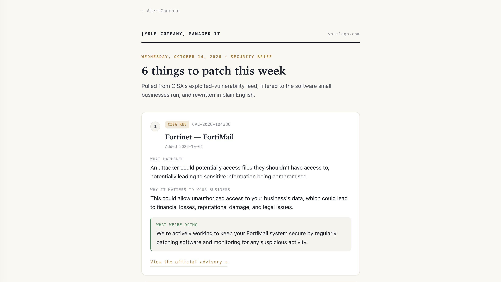
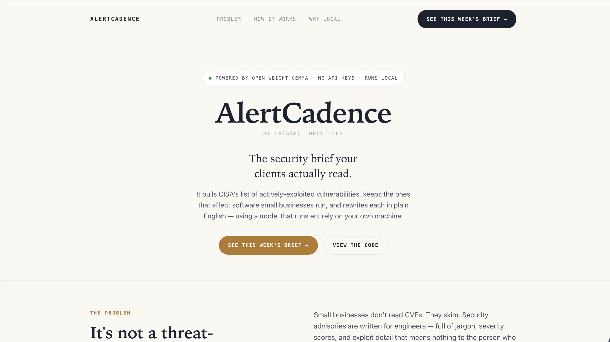

# AlertCadence

Plain-English security briefs for small businesses — generated by a local open model.

Built for the [Hacktoberfest 2026 Open-Source AI Challenge, Week 2: Side Hustle](https://dev.to/challenges).
A project by [DataSec Chronicles](https://www.datasecchronicles.com).

**Live site:** [alertcadence.tech](https://alertcadence.tech)



*A real brief, generated from live CISA data by a local model — each advisory in plain English, ransomware-linked ones first.*

## What it does

Security advisories are written for engineers. A small-business owner doesn't
read "path traversal via crafted request" — they skim it and move on.

AlertCadence translates. It pulls CISA's feed of **actively-exploited**
vulnerabilities, keeps the ones affecting software small businesses actually
run, and rewrites each into three plain sentences:

- **What happened** — the issue, in plain English
- **Why it matters to your business** — the practical risk
- **What we're doing** — reassuring, proactive language an MSP would use

The result is one clean HTML brief an MSP can review and send to a client.

## How it works

```
fetch.py    →  pull CISA KEV feed, filter to last 30 days + SMB vendors,
               rank ransomware-linked first  →  advisories.json
build.py    →  extract clean facts (extract.py) + summarize each with a
               local model (translate.py)  →  summaries.json
store.py    →  store advisories + summaries in MongoDB (local fallback)
render.py   →  render one HTML newsletter  →  newsletter.html
```

**The key design choice:** the model never sees the raw advisory. A
deterministic Python step (`extract.py`) pulls out a small fixed set of facts
— vendor, product, flaw type, ransomware flag — and the model only ever
receives those. It can't leak exploit syntax it never sees, and it can't drift
on relevance it never judges. The guardrail is the architecture, not the prompt.

When an advisory's detail is thin, the model is told to say so plainly rather
than invent a mechanism — important for anything going out under an MSP's name.



## Stack

- **Local open-weight model** — Google Gemma (`gemma2:2b`) via [Ollama](https://ollama.com). Runs entirely on your own machine; no API keys, no data leaves the box.
- **Data source** — [CISA Known Exploited Vulnerabilities](https://www.cisa.gov/known-exploited-vulnerabilities-catalog) (everything in it is confirmed exploited, so risk is pre-filtered).
- **Storage** — MongoDB Atlas (a durable history of every brief generated), with a local JSON fallback so the pipeline never breaks if the database is unreachable.
- **Output** — a self-contained HTML brief, hosted static on GitHub Pages.

## Run it yourself

```bash
pip install pymongo                          # for the storage step
ollama pull gemma2:2b                         # the local model

python3 fetch.py                              # -> advisories.json
python3 build.py                              # -> summaries.json  (needs Ollama running)
export ALERTCADENCE_MONGO_URI="mongodb+srv://..."   # optional; falls back to local JSON
python3 store.py                              # -> MongoDB (or storage_fallback.json)
python3 render.py                             # -> newsletter.html
```

Open `index.html` for the landing page; it links to the generated `newsletter.html`.

## What's next

- A regression test on the "detail not public" cases, so a model or prompt
  change that starts filling blanks fails loudly instead of being caught by luck.
- A formal review/approval gate before a brief goes out.
- Export to PDF / email, scheduling, and a per-industry filter.
- A hosted version so the briefs regenerate on their own.

Today, a human reviews every brief before it's shared. That's by design, not a gap.

---

Made with 💜 by [DataSec Chronicles](https://www.datasecchronicles.com) ·
*The tool changes, the question doesn't.*
